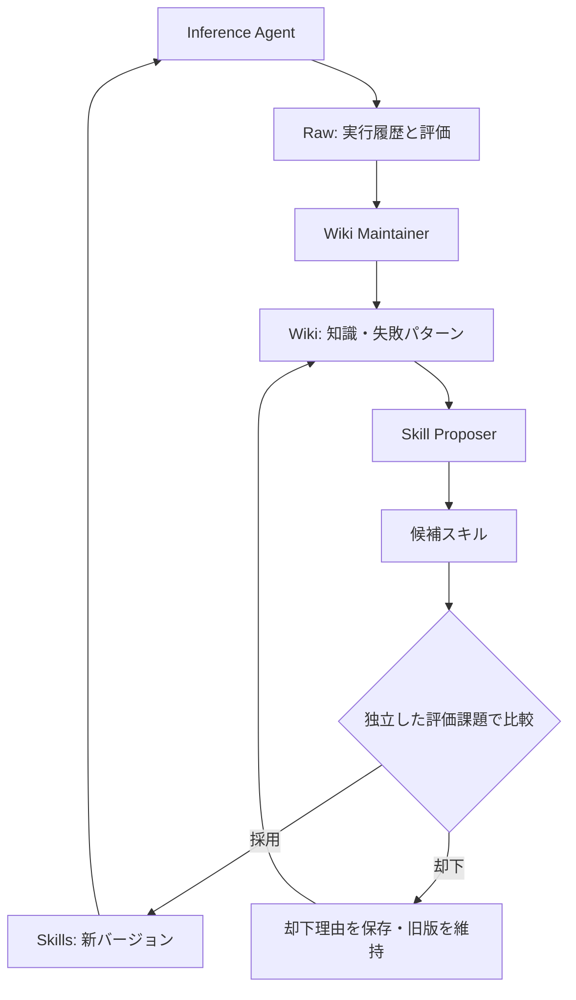
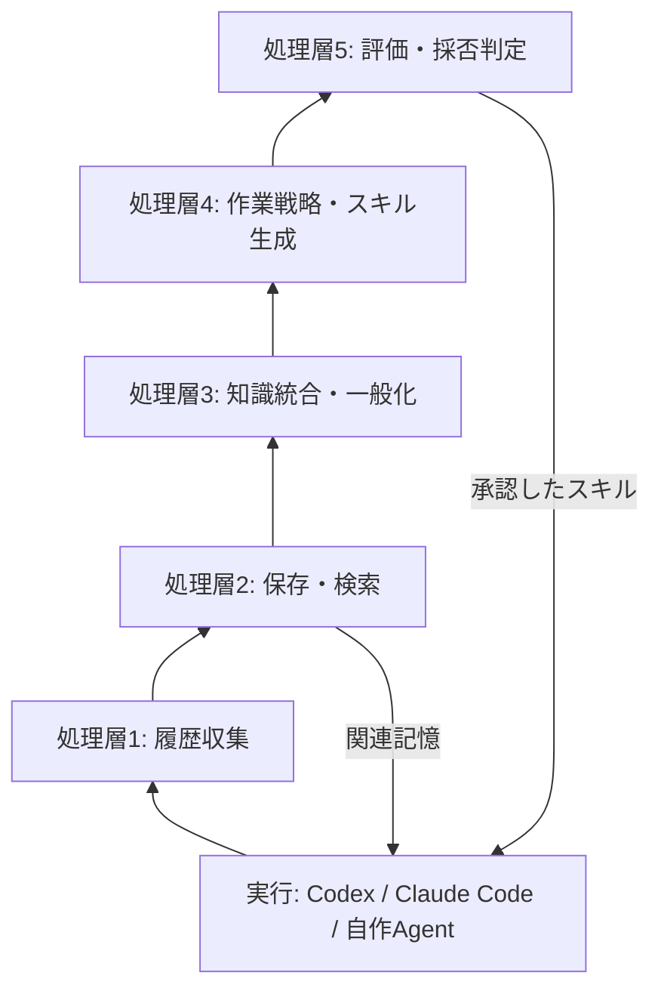
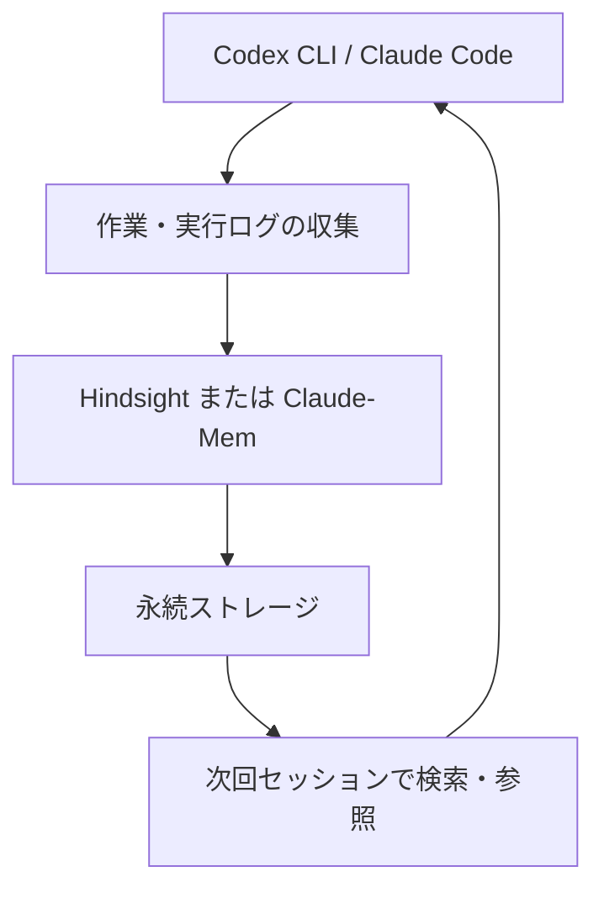
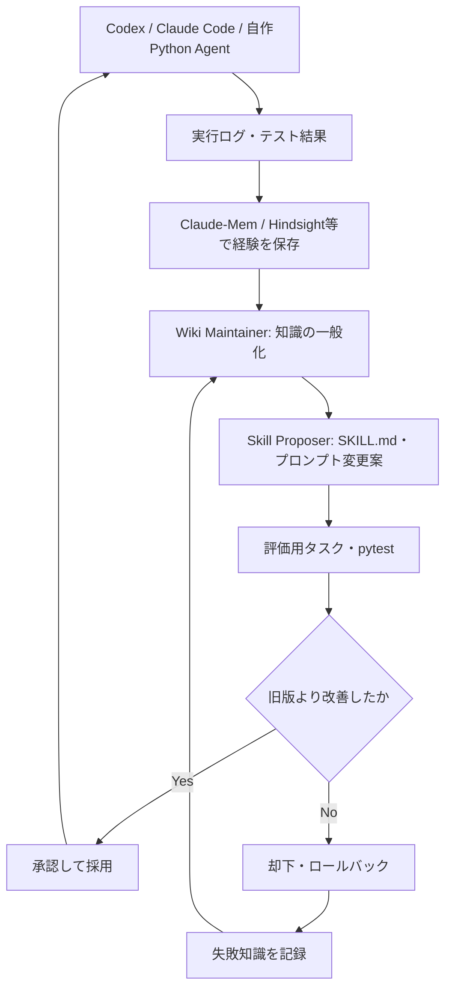

# AIエージェントのナレッジ蓄積・再利用技術 調査レポート

**作成・改訂日：** 2026年11月24日  
**調査対象：** WikiSkillおよび経験・知識・スキルの蓄積と再利用に関する8技術（計9技術）  
**想定環境：** Windows 11、Debian/Linux、Docker、Python、Codex CLI、Claude Code  
**調査の位置づけ：** 先行調査の公開情報を統合・再構成した技術比較資料。実機導入・性能再現は未実施。

> **要旨**  
> ナレッジの再利用は、経験の記録、知識の検索・統合、作業手順の改善、改善効果の評価という異なる責務を持つ。
> Claude-Memは主に作業履歴の再利用、WikiSkillは主にスキルの継続改善を担うため、単純な上位・下位関係ではない。
> 作業能力そのものを改善したい場合は、WikiSkill、Knowledge Compiler、ACE、LangMemを中心に比較し、必要に応じて記憶基盤を組み合わせる。

## 目次

1. [調査目的と比較方法](#1-調査目的と比較方法)
2. [作業範囲・粒度と機能カバレッジ](#2-作業範囲粒度と機能カバレッジ)
3. [用途別の技術選定と導入可能性](#3-用途別の技術選定と導入可能性)
4. [技術別の仕組み・適用範囲・限界](#4-技術別の仕組み適用範囲限界)
5. [技術間の役割分担と構成概念](#5-技術間の役割分担と構成概念)
6. [改善効果の評価方法](#6-改善効果の評価方法)
7. [選定・運用上の注意事項](#7-選定運用上の注意事項)
8. [結論](#8-結論)
9. [参考資料](#9-参考資料)

---

## 1. 調査目的と比較方法

### 1.1 背景と目的

一般的なAIエージェントは、過去の作業で得た知見を後続セッションで十分に再利用できない場合がある。
一方、会話ログを保存するだけでは、誤った手順の修正や古い知識の失効、作業能力の向上が保証されない。
本資料では、WikiSkillに代表される経験からのスキル進化と、その前段階を支える記憶・知識基盤を比較する。
公開コード、サンプル、評価方法など、第三者が検証・再現するための資料が存在する技術を優先する。

### 1.2 作業規模の分類

| レベル | 作業規模 | 例 |
|---|---|---|
| L1 | 単一操作 | コマンド、ファイル編集、API呼び出し |
| L2 | 個別タスク | SQL作成、関数実装、エラー修正 |
| L3 | 複合タスク | 認証機能実装、DB移行、障害調査 |
| L4 | セッション・工程 | 要件整理から実装・テストまで |
| L5 | プロジェクト | 設計方針、構成、開発規約、進捗 |
| L6 | プロジェクト横断 | 共通開発手法、汎用スキル、組織ナレッジ |

これは本資料独自の分類であり、各技術の公式仕様や処理能力の上限ではない。
L6は知識を共有・移植できる範囲を意味し、複数プロジェクトを自律管理できるという意味ではない。

### 1.3 知識の抽象度（作業規模とは別軸）

| 層 | 知識の粒度 | 例 | 主な担当技術 |
|---|---|---|---|
| K1 | 生の実行履歴 | コマンド、エラー、テスト結果 | Hooks、Claude-Mem、WikiSkillのRaw |
| K2 | 個別経験・事実 | DB_HOSTを変更して接続エラーが解消した | Claude-Mem、Mem0、Hindsight |
| K3 | 統合・一般化された知識 | コンテナ間のDB接続ではサービス名を確認する | Hindsight、LangMem、WikiSkillのWiki、Knowledge Compiler |
| K4 | 再利用可能な手順・戦略 | DB障害の調査手順、開発プレイブック | WikiSkill、ACE、LangMem、Knowledge Compiler |

GraphitiはK2〜K3の事実・関係・時間変化、OpenVikingはK2〜K4の情報資産管理を担う。
K4を保存できることと、K4を経験から生成・評価・更新できることは区別する。
また、記憶の抽象度が高くても、対象作業が大規模とは限らない。

### 1.4 評価軸

| 評価軸 | 確認する内容 |
|---|---|
| 作業規模 | 主に再利用するタスク・工程・プロジェクトの範囲 |
| 入力と蓄積粒度 | 何を収集し、どの単位で知識を保存するか |
| 機能カバレッジ | 収集、抽出、検索、統合、手順生成、評価・改善 |
| 改善対象 | 記憶、知識、プロンプト、スキル、戦略のどれか |
| 導入再現性 | 公開実装、手順、サンプル、評価コードの有無 |
| 利用形態・運用負荷 | CLI、SDK、サーバー、DB、LLM、認証、保守 |

再現性の評価は公開資料の充実度であり、インストール成功や論文の性能再現を保証しない。

## 2. 作業範囲・粒度と機能カバレッジ

### 2.1 4種類の技術分類

| 分類 | 技術 | 主な責務 |
|---|---|---|
| 経験蓄積型 | Claude-Mem、Mem0 | 履歴や事実の記録・検索、引き継ぎ |
| 知識構築型 | Graphiti、Hindsight | 関係性、時間変化、複数経験からの洞察 |
| 知識資産管理型 | OpenViking | 文書、記憶、スキルの階層管理・取得 |
| 作業能力改善型 | LangMem、ACE、Knowledge Compiler、WikiSkill | 行動指針、プレイブック、スキルの改善 |

主たる設計目的による分類であり、複数の分類にまたがる機能を持つ技術もある。

### 2.2 作業規模の比較

| 技術 | 主な適用範囲 | 応用可能な範囲 | 適用範囲の意味 |
|---|---|---|---|
| Claude-Mem | L1〜L4 | L1〜L5 | 操作・タスク・セッションの記憶、案件の引き継ぎ |
| Mem0 | L2〜L5 | L1〜L6 | 事実・設定・ユーザーやエージェントの記憶 |
| Graphiti | L2〜L5 | L1〜L6 | 業務やシステムの関係・変更履歴 |
| Hindsight | L2〜L5 | L1〜L6 | 経験の想起と複数事例からの考察 |
| OpenViking | L3〜L6 | L1〜L6 | 文書・スキル・プロジェクト資産の管理 |
| LangMem | L2〜L5 | L1〜L6 | エージェントの行動指針・プロンプト |
| ACE | L2〜L5 | L2〜L6 | 特定タスク領域の解決戦略 |
| Knowledge Compiler | L2〜L6 | L1〜L6 | 技術知識・個別スキルの整理と改善 |
| WikiSkill | L2〜L5 | L1〜L6 | 同種タスクで繰り返し利用するスキル |

範囲は先行調査からの定性的な見立てであり、実測による境界ではない。
例えばWikiSkillはL2のSQL作成にも適用でき、Claude-MemはL5の案件知識を記憶できる。
L5〜L6への展開はスコープ設定、権限、知識の一般化、対象領域ごとの評価などを必要とする場合がある。

### 2.3 入力・蓄積・再利用単位

| 技術 | 入力 | 蓄積する単位 | 再利用・改善の対象 |
|---|---|---|---|
| Claude-Mem | ツール操作・実行履歴 | 作業記録・セッション要約 | 継続作業のコンテキスト |
| Mem0 | 会話・イベント | 個別の事実・設定・嗜好 | ユーザー・エージェントの記憶 |
| Graphiti | 会話・文書・イベント | エンティティ・関係・有効期間 | 時間変化を伴う知識 |
| Hindsight | 会話・経験・文書 | 事実・経験・洞察 | プロジェクトやエージェントの判断材料 |
| OpenViking | 文書・コード・会話・スキル | 階層化した知識資産 | 必要なコンテキスト・手順の取得 |
| LangMem | 会話・実行結果・評価 | 事実・行動指針 | プロンプト・エージェントの行動 |
| ACE | タスク・実行結果・評価 | 戦略・ルールの集合 | プレイブック |
| Knowledge Compiler | 文書・実行履歴・エラー | Wiki・失敗パターン・スキル | 技術知識・個別スキル |
| WikiSkill | タスク・成功失敗・評価 | Wiki・一般化されたスキル | 評価を通じた個別スキルの改善 |

### 2.4 ナレッジ処理工程のカバレッジ

| 技術 | 収集・記録 | 要約・抽出 | 検索・想起 | 統合・一般化 | 手順生成 | 評価・改善 |
|---|:---:|:---:|:---:|:---:|:---:|:---:|
| Claude-Mem | ◎ | ◎ | ◎ | △ | — | — |
| Mem0 | ○ | ◎ | ◎ | ○ | — | — |
| Graphiti | ○ | ◎ | ◎ | ◎ | — | — |
| Hindsight | ○ | ◎ | ◎ | ◎ | △ | — |
| OpenViking | ○ | ◎ | ◎ | ◎ | ○ | △ |
| LangMem | ○ | ◎ | ◎ | ◎ | ◎ | △ |
| ACE | ○ | ◎ | ○ | ◎ | ◎ | ○ |
| Knowledge Compiler | ◎ | ◎ | ◎ | ◎ | ◎ | ◎ |
| WikiSkill | ◎ | ◎ | ○ | ◎ | ◎ | ◎ |

**凡例：** ◎＝中心機能、○＝対応、△＝部分対応・追加実装が必要、—＝中心機能ではない。
評価・改善は検索精度ではなく、作業手順・スキルの改善を指す。
WikiSkillの検索は主に知識の分析・スキル提案工程を対象とし、通常の実行時にWiki全体を検索させることを意味しない。
Knowledge Compilerの評価機構も任意の開発タスクに対する自動的な品質保証ではない。

### 2.5 Claude-MemとWikiSkillの違い

共通事例：FastAPIとPostgreSQLをDocker Composeで開発し、DB接続エラーが発生した場合。

| 工程 | Claude-Mem | WikiSkill |
|---|---|---|
| 経験収集 | 前回の接続エラー・修正・結果を記録 | 複数の実行結果と評価を収集 |
| 知識化 | localhostからサービス名への変更で解決したことを記録 | コンテナ間通信に関する失敗パターンを一般化 |
| 再利用 | 次回の障害発生時や作業開始時に記憶を検索 | 作業前に接続設定を確認する手順を提案 |
| 評価 | 記憶の有用性は別途測る | 旧版・新版の手順を評価課題で比較し採否判定 |
| 期待効果 | 再調査・引き継ぎコスト削減 | 解決戦略の改善、同種障害の予防 |

Claude-Memでも一般化された知識を保存でき、WikiSkillでも個別ログを扱う。
両者の違いは記憶内容の厳密な上限ではなく、設計目的と改善ループの有無にある。

## 3. 用途別の技術選定と導入可能性

### 3.1 目的別の選定

| 管理・改善対象 | 第一候補 | 補完候補 |
|---|---|---|
| 開発進捗・引き継ぎ | Claude-Mem | Hindsight |
| 複数エージェント間の経験共有 | Hindsight | Claude-Mem（収集） |
| プロジェクトの設定・制約 | Mem0 | OpenViking |
| 設計・仕様の変更履歴 | Graphiti | Hindsight |
| ソースコード・技術資料の整理 | OpenViking | Knowledge Compiler |
| 障害・成功事例の体系化 | Hindsight、Knowledge Compiler | Claude-Mem |
| エージェントの行動指針改善 | LangMem | Hindsight |
| 作業戦略・プレイブック改善 | ACE | Hindsight |
| スキルの生成・検証・採否判定 | WikiSkill、Knowledge Compiler | Claude-Mem、Hindsight |

### 3.2 導入再現性・負荷

| 技術 | 資料ベースの導入再現性 | 導入負荷（目安） | 提供形態・連携 |
|---|---|---|---|
| Claude-Mem | 高 | 低 | コーディングエージェント向けインストーラー |
| Mem0 | 高 | 低〜中 | SDK、独自連携 |
| Graphiti | 高 | 中〜高 | グラフDB、SDK、MCP/REST |
| Hindsight | 高 | 中 | Docker、SDK、Coding Agents連携 |
| OpenViking | 高 | 中 | サーバー、CLI、エージェント連携 |
| LangMem | 高 | 中 | Python、LangGraph、永続ストア |
| ACE | 中〜高 | 中〜高 | 研究コード、評価スクリプト |
| Knowledge Compiler | 高 | 中〜高 | CLI、サンプルVault、テスト、評価設計 |
| WikiSkill | 論文・関連実装あり | 高 | 研究方式、独立実装または既存技術による構築 |

WikiSkillの研究方式と、第三者実装・GoogleCloudPlatformの関連プロジェクトは区別する。
公開資料の有無に基づく評価であり、最新バージョンとの互換性、認証、依存関係は未検証である。

## 4. 技術別の仕組み・適用範囲・限界

以下では記憶基盤から作業能力改善へ順に整理する。
各技術について、公式情報に基づく機能と、本資料での適用例・評価を区別する。

### 4.1 Claude-Mem

**分類：** 経験蓄積型  
**主な適用範囲・抽象度：** L1〜L4 / K1〜K2  
**担当範囲：** 操作、セッションの記録を次回の作業に再利用する。

**開発への適用例と境界：** 過去のファイル修正や障害原因を思い出す。スキルの検証・更新は別責務。

- **リポジトリ：** <https://github.com/thedotmack/claude-mem>
- **目的：** コーディングエージェントの作業履歴を継続的に保存し、後続セッションへ引き継ぐ。
- **仕組み：** Hooksなどから作業・ツール実行情報を収集し、要約・抽出した知識を検索して再利用する。
- **保存・検索：** SQLite/FTS5による全文検索やベクトル検索の構成が案内されている。
- **向く用途：** 個人開発、複数セッションにまたがる不具合対応、仕様変更履歴の引き継ぎ。

**利点：** 既存の開発フローへの追加が比較的容易で、最小構成を試しやすい。

**注意点：** 記憶の収集・検索が中心であり、`SKILL.md`の変更を自動でテストして採否判定する機能とは別に考える必要がある。

### 4.2 Mem0

**分類：** 経験蓄積型  
**主な適用範囲・抽象度：** L2〜L5 / K2  
**担当範囲：** 会話やイベントから事実を抽出し、指定した記憶スコープで再利用する。

**開発への適用例と境界：** uvの採用、DB構成、命名規則を記憶する。自動的な作業能力改善は別途実装。

- **リポジトリ：** <https://github.com/mem0ai/mem0>
- **目的：** AIアプリケーションに長期記憶の保存・検索・更新機能を追加する。
- **形態：** Pythonライブラリおよび周辺サービス。
- **向く用途：** FastAPI、社内チャットボット、独自のツール呼び出しエージェント。

**利点：** Pythonの既存システムへAPIとして組み込みやすい。

**注意点：** LLM APIやベクトルDBへの依存は選択する構成によって異なる。
記憶の保持だけではスキル改善の評価・ロールバックはできない。

### 4.3 Graphiti

**分類：** 知識構築型  
**主な適用範囲・抽象度：** L2〜L5 / K2〜K3  
**担当範囲：** 知識の関係性と時間変化を構造化する。

**開発への適用例と境界：** SQLiteからPostgreSQLへの移行やAPI依存関係を管理する。作業戦略の生成・評価は別責務。

- **リポジトリ：** <https://github.com/getzep/graphiti>
- **目的：** エンティティ間の関係と時間的変化を扱えるナレッジグラフを構築する。
- **特徴：** 「エラー → 原因 → 対策」の関係や、事実の有効期間・更新を扱える。
- **向く用途：** 頻繁に変化する仕様、複数の関連要因をもつ障害、履歴を伴う業務知識。

**利点：** 単純な文章検索より、事実の関連性・変化を重視するユースケースに適する。

**注意点：** グラフDBや抽出処理の運用負荷がある。
公開サンプルのMCP/RESTサーバーを本番公開する場合、認証・認可・接続制限を必ず確認する。

### 4.4 Hindsight

**分類：** 知識構築型  
**主な適用範囲・抽象度：** L2〜L5 / K2〜K3  
**担当範囲：** 個々の経験を保持・想起し、複数事例から洞察を得る。

**開発への適用例と境界：** 複数のDB障害から原因の傾向や有効な対応を考察する。洞察を検証済みスキルに変換する処理は別途必要。

- **リポジトリ：** <https://github.com/vectorize-io/hindsight>
- **目的：** エージェントが経験を保持・検索し、蓄積済みの経験から洞察を生成する。
- **主な操作：** `retain`（保持）、`recall`（検索）、`reflect`（考察）。
- **提供形態：** サーバー、Pythonクライアント、Coding Agents向け連携。
- **向く用途：** CodexとClaude Codeをまたいだ記憶共有、プロジェクト別の履歴管理、継続運用するAIエージェント。

**利点：** 独立サーバーとして運用でき、複数クライアントから共通の記憶へアクセスする構成を検討できる。

**注意点：** 永続ストレージ、LLM接続、ネットワークアクセス制御を含めて設計する必要がある。

### 4.5 OpenViking

**分類：** 知識資産管理型  
**主な適用範囲・抽象度：** L3〜L6 / K2〜K4（管理対象）  
**担当範囲：** 記憶・資料・スキルを階層化して必要な情報を取得する。

**開発への適用例と境界：** 複数案件の設計書・コード・スキルを整理する。スキル抽出と品質評価・採用判定は区別する。

- **リポジトリ：** <https://github.com/volcengine/OpenViking>
- **目的：** エージェントの記憶、文書、スキルを統一的に整理・検索するコンテキスト基盤。
- **特徴：** 概要（L0）→ 要約（L1）→ 詳細（L2）の段階的読み込み。
- **向く用途：** 複数プロジェクトの情報集約、長文ナレッジから必要な情報だけを参照するシステム。

**利点：** 保存する情報の粒度を分け、コンテキスト使用量を制御する設計がある。

**注意点：** モデル接続などの初期設定が必要。
AGPLv3ライセンスに関して、改変・ネットワーク経由の利用を含む提供形態を法務・社内規則と照合する。

### 4.6 LangMem

**分類：** 作業能力改善型  
**主な適用範囲・抽象度：** L2〜L5 / K2〜K4  
**担当範囲：** 経験を知識や行動指針へ統合し、プロンプトの改善を支援する。

**開発への適用例と境界：** レビューで繰り返し指摘されたテスト不足から、完了前のテスト指示を改善する。評価ゲートは自作する。

- **リポジトリ：** <https://github.com/langchain-ai/langmem>
- **目的：** 対話・実行履歴からメモリを抽出・統合し、プロンプトを継続改善する。
- **API例：** `create_manage_memory_tool`、`create_search_memory_tool`、`create_memory_store_manager`、`create_prompt_optimizer`。
- **向く用途：** LangGraph系エージェント、独自Pythonエージェント、知識整理・改善ループ。

**利点：** 保存だけでなく、知識の統合・プロンプト改善の実装部品を提供する。

**注意点：** メモリの永続化は別途構成が必要。
たとえば`InMemoryStore`はプロセス終了で内容が消えるため、長期運用には永続ストアが必要となる。
プロンプト変更の採否判定には評価タスクを用意する。

### 4.7 ACE（Agentic Context Engineering）

**分類：** 作業能力改善型  
**主な適用範囲・抽象度：** L2〜L5 / K3〜K4  
**担当範囲：** 実行経験を再利用可能な戦略の集合へ反映する。

**開発への適用例と境界：** API実装やDB移行時に有効な確認手順をプレイブックへ蓄積する。任意のプロジェクト全体を自律進化させるものではない。

- **リポジトリ：** <https://github.com/ace-agent/ace>
- **目的：** タスク実行時の経験をプレイブックへ差分反映し、次回の実行に再利用する。
- **考え方：** Generator、Reflector、Curatorという役割で、実行・反省・知識更新を分ける。
- **向く用途：** 自作エージェントの戦略改善、学習・検証データを用いた反復実験。

**利点：** 知識を全面的に書き換えるのではなく、既存の有効なプレイブックを維持しながら更新する発想が参考になる。

**注意点：** Codexへ直接導入する完成済みプラグインではなく、研究コードの評価系を自分のタスクへ移植する作業が必要。

### 4.8 Knowledge Compiler

**分類：** 作業能力改善型  
**主な適用範囲・抽象度：** L2〜L6 / K1〜K4  
**担当範囲：** 技術資料と実行経験をWiki化し、スキル改善・評価へ接続する。

**開発への適用例と境界：** 障害原因を体系化し、関連スキルの変更案を評価する。評価対象や採用手順の整備は必要。

- **リポジトリ：** <https://github.com/GoogleCloudPlatform/knowledge-compiler>
- **目的：** エージェント経験の分析、Wiki型ナレッジの構築、スキル改善案の検証。
- **特徴：** サンプルVault、lint、検索、trace解析、スキル評価関連コード。
- **向く用途：** WikiSkill型のパイプラインの再現検討、改善案の採否評価機構の参考実装。

**利点：** 単なる記憶保存よりも、スキル改善・評価という研究目的に近い。

**注意点：** GoogleCloudPlatform配下の公開リポジトリであっても、Googleの正式サポート製品と同一視しない。
任意の開発案件で自動改善を実現するには、評価課題・変更適用範囲・ロールバック方法を自作または整備する必要がある。

### 4.9 WikiSkill

**分類：** 作業能力改善型  
**主な適用範囲・抽象度：** L2〜L5 / K1〜K4（Raw・Wiki・Skills）  
**担当範囲：** 経験の永続化から、個別スキルの改善案生成、評価・採否判定まで。

- **研究論文：** <https://arxiv.org/abs/2608.27454>（WikiSkill: Compiling Agent Experience into Persistent Knowledge for Skill Evolution）
- **目的：** モデルの重みを変更せず、反復タスクの経験からスキルを改善する。
- **構成：** Raw（原始履歴）、Wiki（分析・一般化した知識）、Skills（実行手順）の3層。
- **改善工程：** Inference Agent、Wiki Maintainer、Skill Proposer、Gating & Rollback。
- **特徴：** 改善案が却下されても失敗知識を保持し、同じ改善の失敗を繰り返さないことを目指す。通常のタスク実行ではWiki全体ではなく実行スキルを参照する構成を採用できる。

**開発への適用例と境界：** DB障害調査、API実装、テスト作成など、同種のタスクに繰り返し使うスキルを改善する。
L5〜L6に展開するには対象スキルの分離、プロジェクト固有情報の分離、横断評価が必要。
エージェントの目的・権限・アーキテクチャ全体を自動変更する技術ではない。

**再現のための資料・実装候補：**

- 論文全文：<https://arxiv.org/html/2608.27454>
- 独立実装（Python）：<https://github.com/kenhuangus/wikiskill>
- 独立実装（TypeScript）：<https://github.com/ranjithrajv/wikiskill>
- 関連実装：Knowledge Compiler（4.8節）

これらは先行調査で挙げた参照先であり、論文著者の公式完全再現コードや正式サポート製品として確認したものではない。
対応モデル、ライセンス、評価方法、ログ形式の差異は実装ごとに確認が必要である。

**WikiSkillとの比較：** Knowledge CompilerはWiki・個別スキル・評価の構成が近く、ACEはプレイブック、LangMemはプロンプトを改善する点が近い。
OpenViking・Hindsightは知識管理や洞察で補完し、Claude-Mem・Mem0・Graphitiは記憶の収集・構造化・検索で補完する。

---

## 5. 技術間の役割分担と構成概念

### 5.1 ナレッジ処理の責務分離

| 処理層 | 候補技術 | 出力 |
|---|---|---|
| 1. 履歴収集 | Claude-Mem、Hooks | 実行ログ・作業記録 |
| 2. 保存・検索 | Mem0、Graphiti、Hindsight、OpenViking | 関連する記憶・文書・関係性 |
| 3. 知識統合 | Hindsight、LangMem、Knowledge Compiler、WikiSkill | 根拠付きの一般化知識 |
| 4. 手順生成 | LangMem、ACE、Knowledge Compiler、WikiSkill | スキル・プレイブック・プロンプト案 |
| 5. 評価・採否 | WikiSkill、Knowledge Compiler、独自評価系 | 採否・評価記録・有効なバージョン |

処理層番号は1章の作業規模L1〜L6とは異なる。
全層に別々の製品を導入する必要はない。必要な責務を重複なく選び、実行エージェントと改善エージェントの権限を分離する。

### 5.2 構成A：開発履歴の自動記憶

**期待効果：** セッションをまたぐ仕様・判断・解決策の引き継ぎ、同一エラーの再調査削減。

**役割の違い：** Hindsightは複数エージェント間の記憶共有、Claude-Memは作業履歴の収集と引き継ぎを中心とする。

**評価観点：** 保存される情報の範囲、機密情報のマスキング、記憶の有効性、誤った記憶の削除・修正。

### 5.3 構成B：経験からのスキル自己改善

これは**製品として用意された単一の公式構成ではなく、複数の公開コンポーネントを組み合わせる設計案**である。

**品質管理上の原則：**

1. **Raw、Wiki、Skillsを分離する。** 原始ログを上書きせず、分析結果と実行ルールを別々に管理する。
2. **変更案を本番へ即時反映しない。** 検証環境で旧版と新版を比較する。
3. **失敗した改善案も記録する。** 同じ変更を繰り返し提案することを防ぐ。
4. **機密情報は保存前に処理する。** APIキー、パスワード、個人情報、顧客コードを記憶へ混入させない。
5. **承認と権限制御を分離する。** スキル変更の自動反映には十分な評価と安全性の確認が必要となる。

Claude-Memからの記憶・生ログの取り出し、Wiki側への受け渡し、評価実行、Gitによる版管理は接続実装が必要である。
標準のClaude-MemとWikiSkill連携として確認した構成ではない。
知識を直接検索して使う経路と、評価済みスキルを使う経路を分けて効果を測定する。

## 6. 改善効果の評価方法

記憶の利用効果とスキルの改善効果を分けて評価する。以下は比較実験の設計案であり、実測結果ではない。

### 6.1 比較実験の設計

| 実験群 | 記憶検索 | 改善済みスキル | 確認する効果 |
|---|---|---|---|
| A：基準 | なし | なし（旧版） | 基本性能 |
| B：記憶のみ | あり | なし（旧版） | 経験・知識の再利用効果（BとA） |
| C：スキルのみ | なし | あり | 手順改善の効果（CとA） |
| D：併用 | あり | あり | 組み合わせの効果（DとB/C） |

モデル、ツール、実行予算、権限、評価課題、リポジトリの初期状態を揃える。
記憶検索を無効化する群でも、改善案作成に使う学習データは事前に固定し、評価課題を混入させない。
L2の個別修正、L3の機能実装、L4の一連の開発工程など、規模ごとに成功率と費用を集計する。
横断再利用（L6）を評価する場合は、学習に使っていない別プロジェクトでも検証する。

### 6.2 指標案

| 指標 | 測定方法 | 見たい変化 |
|---|---|---|
| タスク成功率 | 同じ難易度の課題群で記憶あり/なし、旧版/新版を比較 | 上昇 |
| 同一エラー再発率 | 解決済み類型のエラー発生数を記録 | 低下 |
| 検索正確性 | 取得した記憶の妥当性を人が確認 | 上昇 |
| 旧情報の誤利用率 | 古い仕様を参照させた場合の誤答数 | 低下 |
| トークン/API費用 | 同条件でタスク当たりの総使用量を計測 | 許容範囲内 |
| 処理時間 | タスク開始から正常終了まで計測 | 許容範囲内 |
| 改善採用率 | 提案数に対する評価合格数 | 継続計測 |
| ロールバック可能性 | 意図的に悪い変更案を投入して復旧確認 | 確実に復旧 |

小規模PoCでは20件程度から課題群を作成することも考えられるが、統計的な結論を出すには反復試行や十分なサンプル数が必要。
**学習課題と評価課題は分離する。** 同一課題の繰り返しは一般化性能の証明にならない。

## 7. 選定・運用上の注意事項

### 7.1 記憶に保存するデータ

- コーディングエージェントのログには、コード断片、パス、環境変数、APIキー、顧客情報が含まれ得る。
- ローカルDBへ保存していても、要約・埋め込み作成にクラウドAPIを使えばデータ送信が発生する。
- 保存期間、検索権限、削除方法、バックアップ、暗号化を事前に決める。

### 7.2 自動改善の安全性

- エージェントが生成したルールは、誤りや根拠のない一般化を含む場合がある。
- `SKILL.md`の変更はバージョン管理し、差分・評価結果・採用理由を残す。
- 本番環境の変更、権限昇格、外部送信、機密ファイル参照などの行為をスキルから無制限に許可しない。

### 7.3 技術選定の落とし穴

- 記憶検索の性能と、エージェントの最終的な仕事の成功率は異なる。
- ベクトル検索を採用すれば自動的に正確な記憶になるわけではない。
- 多数の記憶をプロンプトへ注入すると、費用・遅延・誤情報の影響が増える可能性がある。
- 新しく公開されたリポジトリの安定性や将来の保守状況は、別途追跡が必要。

## 8. 結論

技術選定は、まず記憶・知識構築・資産管理・作業能力改善のどれが目的かを決め、その後に作業規模と実装負荷を比較する。

開発の継続性が目的ならClaude-MemまたはHindsight、個別事実の保存ならMem0、関係と履歴の管理ならGraphiti、文書やスキルの横断管理ならOpenVikingが候補となる。
一方、経験から作業方法を進化させたい場合は、WikiSkill・Knowledge Compiler・ACE・LangMemが中心候補となる。

作業能力改善型の評価では、Raw / Wiki / Skillsの責務分離と、独立した評価課題での改善案の比較が重要である。
評価を伴わない知識の蓄積だけで自己改善が成立したと判断しない。

将来的に、ワークフローやエージェント構成自体の自律的改善を求める場合は、Self-Evolving Agents、Agent Harness Optimizationなどの領域も別途調査する必要がある。
今回の9技術を評価した範囲からは、それらの実現や性能を保証できない。

---

## 9. 参考資料

### 9.1 研究・プロジェクト

1. **WikiSkill論文（HTML）** — <https://arxiv.org/html/2608.27454>
2. **WikiSkill論文（PDF）** — <https://arxiv.org/pdf/2608.27454>
3. **Claude-Mem** — <https://github.com/thedotmack/claude-mem>
4. **Hindsight** — <https://github.com/vectorize-io/hindsight>
5. **Mem0** — <https://github.com/mem0ai/mem0>
6. **LangMem** — <https://github.com/langchain-ai/langmem>
7. **Graphiti** — <https://github.com/getzep/graphiti>
8. **OpenViking** — <https://github.com/volcengine/OpenViking>
9. **Knowledge Compiler** — <https://github.com/GoogleCloudPlatform/knowledge-compiler>
10. **ACE（Agentic Context Engineering）** — <https://github.com/ace-agent/ace>
11. **WikiSkillの独立実装（Python）** — <https://github.com/kenhuangus/wikiskill>
12. **WikiSkillの独立実装（TypeScript）** — <https://github.com/ranjithrajv/wikiskill>

### 9.2 検証・出典に関する注記

- 本資料は、先行調査の公開情報と作業範囲・粒度の比較を統合したものである。本改訂でのリンク・公開仕様の再調査は実施していない。
- 具体的な導入・操作手順は本版の対象外とし、公開実装・参考資料・再現性の評価は維持した。
- **本資料作成時に各プロジェクトの実機インストール、性能ベンチマーク、Windows/Debian上での動作試験は実施していない。**
- 正式導入前には、各リポジトリのREADME、最新リリース、ライセンス、セキュリティ上の注意事項を再確認する。
