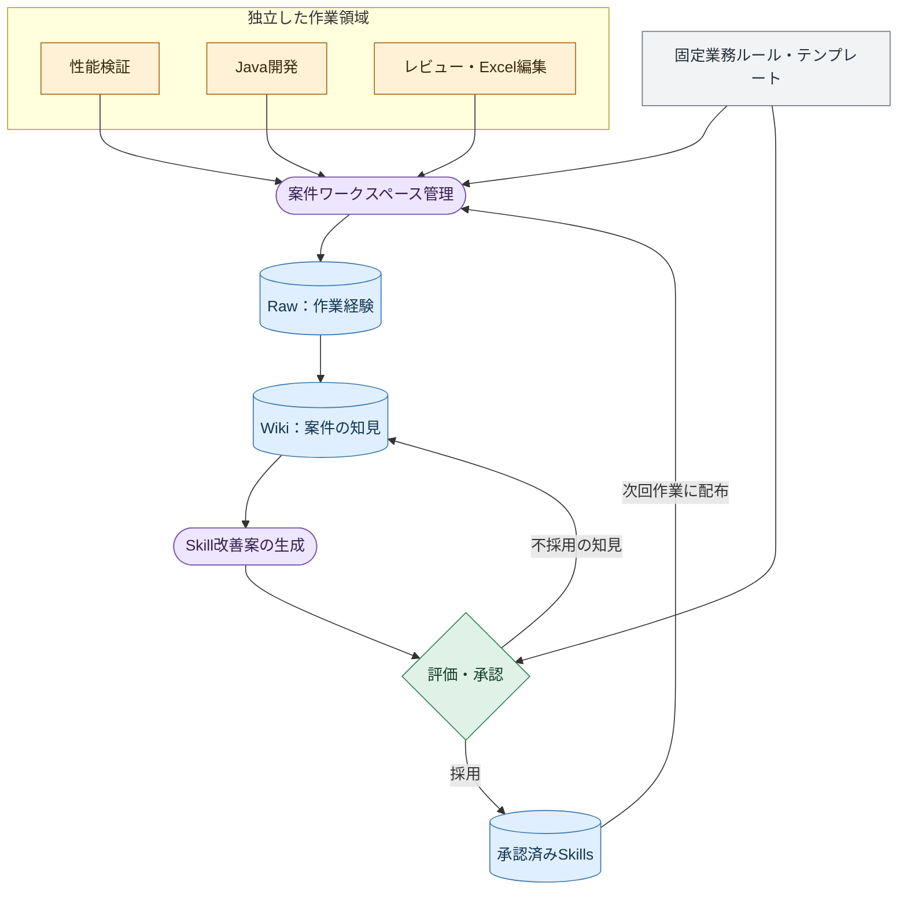
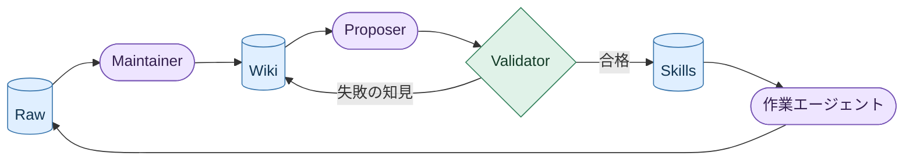
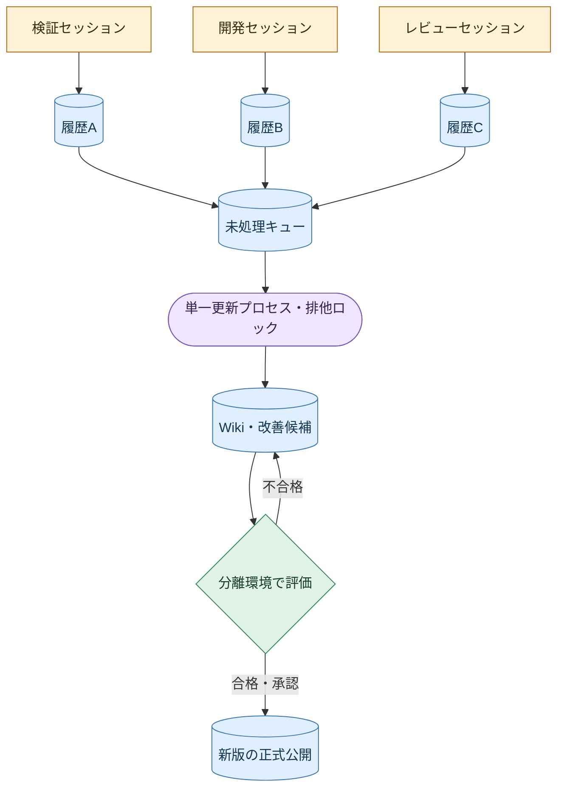

# WikiSkillの技術調査と案件業務への導入設計

**調査基準日：2026年11月25日｜対象：SIerの開発・検証・レビュー・資料作成業務**

> 本資料は、WikiSkillの原論文、公開されている6つの独立実装、および案件単位の導入設計を統合した技術調査資料である。公開仕様に基づく確認事項と、本資料独自の推奨設計を区別する。実機検証・ソースコード全体の監査は未実施。

## 0. エグゼクティブサマリー

**推奨方針：案件ごとに知識とSkillを集約し、作業フォルダは従来どおり自由に作成する。**

| 観点 | 結論 |
|---|---|
| 技術の目的 | AIの作業経験を永続的な知識へ変換し、再利用可能なSkillを継続改善する |
| 適用先 | Java開発、案件固有の検証・テスト・レビュー・マージ、Excel資料作成、成果物管理 |
| 導入単位 | Gitリポジトリや個別タスクではなく、ローカルの案件ルート |
| 並行作業 | 個別作業とログ収集は並列、承認済みWiki・Skillの正式更新は直列 |
| 自動化 | ログ収集・改善対象選定・改善案生成・評価は自動化可能。起動条件と品質保証は実装依存 |
| OSS候補 | poweredbyGEN：案件共有の参考、IvanLukianenko：日常作業からの自動改善、Stahl-G：業務評価 |
| 追加開発 | Git管理外の作業フォルダ認識、エージェント連携、競合制御、業務別評価・承認 |
| 最重要事項 | 正式な業務規則と改善可能な作業手順を分離し、評価されていない変更を業務に適用しない |



図の凡例：角丸＝処理、円筒＝永続データ、ひし形＝評価・承認、四角＝作業または固定資産。これは提案構成であり、単一OSSの標準構成ではない。

---

## 1. WikiSkillとは何か

WikiSkillは、2026年8月27日に公開された論文 *WikiSkill: Compiling Agent Experience into Persistent Knowledge for Skill Evolution* が提案する、エージェントの経験からSkillを進化させるフレームワークである。[1]

モデルの重みを再学習するのではなく、経験・知識・実行手順を外部に保存し、次の作業に利用する。論文はベンチマークでの有効性を報告しているが、今回想定する企業内業務で同等の改善が得られるかは未検証である。

### 1.1 三層構造と役割

| 層 | 保存するもの | 具体例 |
|---|---|---|
| Raw Layer | 作業経験、実行結果、根拠 | 会話、エラー、テスト結果、変更差分、人間の修正指示 |
| Wiki Layer | 経験から抽出した知見 | 失敗原因、成功手順、例外条件、過去の不採用案 |
| Skills Layer | 実行時に利用する再利用可能な手順 | テスト手順、レビュー観点、Excel編集手順、補助スクリプト |

| 処理主体 | 役割 |
|---|---|
| 作業実行エージェント | 通常業務を遂行し、経験を残す |
| Wiki Maintainer | 作業経験を分類・統合して知識にする |
| Skill Proposer | 知識を根拠にSkillの新規作成・修正・変更なしを提案する |
| Validator | 既存版と候補版を評価し、採用または不採用を決める |



原方式の重要な点は、改善案が不採用でも得られた知識を保持することにある。通常の作業エージェントには評価済みSkillを提供し、RawやWiki全体を常時読み込ませる必要はない。案件の事実情報を参照するための検索・資料参照は、必要に応じて別途設計する。

### 1.2 他のナレッジ管理方式との違い

| 方式 | 主に管理する対象 | WikiSkillとの関係 |
|---|---|---|
| セッションメモリ（例：claude-mem） | 会話・作業の記憶、次回への文脈引継ぎ | 記憶の収集・検索を補完。評価付きSkill改善とは異なる |
| Wiki・RAG | 事実、仕様、過去の知見 | Wiki Layerや業務資料参照の補完 |
| Agent Skills | 再利用可能な指示・スクリプト・資料 | WikiSkillが改善・配布する対象 |
| ワークフロー・CI/CD | 実行順序、検証、権限制御 | 必須手順の強制と評価を担う |
| WikiSkill | 経験から知識を形成し、手順を評価付きで改善 | これらをつなぐ継続改善の仕組み |

※ 比較は各技術の主な役割を示す概念整理であり、各製品の全機能を比較したものではない。

## 2. 案件固有業務への適用

### 2.1 適用できる業務

| 業務 | 記憶・ルール化する内容 | 実行手段 | 評価方法 |
|---|---|---|---|
| Java開発 | 実装規約、既存設計、例外処理、禁止事項 | エージェント、Java、Maven/Gradle | ビルド・JUnit・静的解析 |
| 検証・調査 | 環境準備、調査順序、既知の問題、証跡 | Shell、Python、SQL | 再現性、証跡、根拠の妥当性 |
| テスト | テストデータ、実行手順、結果の記録 | JUnit、案件固有コマンド | 期待値、回帰テスト、実施漏れ |
| コードレビュー | 指摘基準、過去の不具合、確認観点 | Git diff、静的解析 | 既知不具合の検出率、誤指摘率 |
| Excel資料編集 | セル配置、書式、変更履歴、テンプレート | openpyxl、Excel COM | 値・数式・書式・保護領域の検査 |
| 成果物の格納 | 命名規則、格納先、上書き条件 | Python、PowerShell | パス、ファイル名、ハッシュ |
| マージ | ブランチ規則、承認条件、競合解消 | Git CLI、CI/CD | 承認・必須チェック・差分の確認 |

WikiSkillが直接ExcelやGitを操作するのではなく、対応ツールを利用するための手順を学習・改善する。人間がエージェントの外で行った操作は自動的には観測されないため、手動フィードバック、ファイル差分、操作記録などを別途取り込む必要がある。

### 2.2 Excel書式・資料作成の再現

自然言語による手順だけに頼らず、既存テンプレートと明示的なルール、検証可能なスクリプトを組み合わせる。[8]

```text
excel-test-report/
├── SKILL.md                         # 適用条件・手順・例外時の対応
├── references/
│   ├── 書式ルール.md
│   ├── セル配置定義.yaml
│   └── 命名・格納規則.md
├── assets/
│   ├── テスト結果テンプレート.xlsx
│   └── 記入済みサンプル.xlsx
└── scripts/
    ├── generate_report.py
    ├── validate_report.py
    └── stage_report.py
```

書式規則の例（架空の案件）：

```yaml
template: テスト結果テンプレート.xlsx
sheet: テスト結果
fields:
  ticket_id: B2
  operator: B3
  result_start_row: 8
format:
  changed_text_color: 'FF0000'
  preserve_formulas: true
  preserve_unedited_cells: true
filename: '{ticket_id}_テスト結果.xlsx'
destination: approved-output-directory
```

- 正式なテンプレートや格納先は人間が管理する。
- AIは入力値の抽出、編集手順、例外処理、検証方法の改善を担当する。
- Excelに図形、マクロ、外部リンク、複雑なレイアウトが含まれる場合は、openpyxlでの保持可否を検証し、必要に応じてWindowsのExcel COMを選択する。[9]
- 実際の共有フォルダへの配置は、検証済みファイルをステージングしてから行う。無断上書きは禁止する。

### 2.3 経験を知識へ変換する例

| 段階 | 内容 |
|---|---|
| 初回作業 | Java改修後に人間が「指定のExcelに結果を記載し、追加箇所は赤文字にする」と指示 |
| Raw | 指示、Excel差分、テスト結果、人間の修正内容を記録 |
| Wiki | 適用条件、テンプレート、赤文字の対象、間違いやすい事項を整理 |
| Skill候補 | テスト結果の転記、書式検証、命名、格納準備の手順を作成 |
| 評価 | 別の模擬案件で資料を生成し、必須項目・色・数式保持・パスを検証 |
| 次回作業 | 適切なSkillを選択し、人間の追加指示なしで実行できることを目指す |

## 3. Skillの分類・選定・更新タイミング

### 3.1 Skillの粒度

案件全体を一つの巨大Skillにせず、独立した作業手順と複数手順を統括するワークフローに分ける。

| Skill | 適用する作業 |
|---|---|
| `java-development` | Java機能実装・改修 |
| `investigation` | 障害調査、性能検証、仕様確認 |
| `testing` | 単体・結合・回帰テスト |
| `code-review` | コードレビュー・指摘対応 |
| `excel-test-report` | テスト結果・エビデンス資料の編集 |
| `artifact-management` | 命名・格納・提出前の確認 |
| `git-merge` | 承認後のマージ準備・実行 |
| `development-workflow` | 複数Skillの適用順序・条件の統括 |

案件共通の必須規則はSkillの自律選択に委ねない。作業開始時に明示的にロードし、必要なものは検証スクリプトや権限で強制する。

### 3.2 「選定」の二つの意味

| 判断 | 主体 | 推奨タイミング |
|---|---|---|
| 今回の作業で使うSkill | 作業エージェント＋作業種別ルーター | 作業開始時・必要に応じ作業中 |
| 改善するSkillの対象 | Skill Proposer | 改善サイクル開始後 |
| 改善サイクルの開始 | Hook、スケジューラー、人間 | セッション蓄積時・定期実行 |
| 改善案の正式採用 | Validator＋必要時の人間承認 | 評価通過後 |

使用頻度、失敗の傾向、人間の修正指示、既存Skillでカバーできない作業などを候補選定に使う。ただし、Skill使用後のエラーだけでそのSkillを原因と断定しない。

### 3.3 自動更新の実装例

IvanLukianenko版では、`.wikiskill/config.json` の以下の設定で起動条件を管理できる。[3]

```json
{
  "auto_loop": "auto",
  "loop_every_sessions": 5,
  "loop_every_days": 3
}
```

未処理の履歴数または経過日数と未処理履歴の有無を、セッション開始時に確認する。`auto` は現在の依頼完了後に改善処理を行い、`suggest` は提案のみ、`off` は手動実行とする。セッションが開始されない日にも処理したい場合はスケジューラーが別途必要になる。

poweredbyGEN版は定期実行による完了セッションの取込みと、グループ単位のSkill改善を提供する。[2]

### 3.4 今回の案件向け推奨運用（設計案）

| 処理 | タイミング |
|---|---|
| ログ収集 | セッション終了時、必要に応じ途中経過も記録 |
| Wiki整理 | 毎日、または未処理経験が一定量に達したとき |
| Skill候補生成・評価 | 夜間や業務の少ない時間帯 |
| 正式採用 | 品質基準と承認条件を満たしたとき |
| 新版の配布 | 次回作業開始時（進行中の作業では原則版を固定） |
| 古い知識・Skillの棚卸し | 月次、業務ルール変更時 |

最初は提案・承認モードで運用し、評価の信頼性が確立してから低リスクの変更のみ自動採用する。

## 4. 公開OSSの比較

原著者の公式実装は今回確認できなかった。以下は原論文を参考にした独立実装であり、同名でも構成・運用思想が異なる。対応状況は公開README等に基づく。人気指標よりも業務への適合性を重視する。

| リポジトリ | 主な方向性 | 対応エージェント・実行環境 | 改善の起動 | 今回の適合性 |
|---|---|---|---|---|
| [poweredbyGEN][2] | 複数Gitリポジトリの共有・定期改善 | Codex（改善処理）、Claude Code等（Skill配布） | 定期実行・CLI | 高：案件集約の参考 |
| [IvanLukianenko][3] | 日常セッションからの自動改善 | Claude Code、OpenCode | セッション数・日数・手動・cron | 高：日常業務収集の参考 |
| [Stahl-G][4] | 評価可能な任意業務・サブエージェント | Codex、Claude Code、その他ホスト連携 | 指示・CLI | 中〜高：Excel等の評価に有力 |
| [ashutoshsinghpr7][5] | 論文再現・評価実験・隔離 | Hermes、Claude Code、Codex、Copilot CLI | CLI・定期実行 | 中：評価基盤の参考 |
| [ranjithrajv][6] | マルチエージェントへの導入 | Claude Code、OpenCode、Codex等 | コマンド | 中：アダプター設計の参考 |
| [kenhuangus][7] | 研究・Web UI・独立実行 | OpenAI互換API・Mock | CLI・Web UI | 低〜中：可視化と研究用 |

### 4.1 今回のフォルダ運用への対応状況

| 機能 | poweredbyGEN | IvanLukianenko | Stahl-G | その他 |
|---|---|---|---|---|
| 案件共通の知識 | Groupで共有 | プロジェクト単位 | 学習バッチ間で引継ぎ | 実装・ワークスペース依存 |
| Git配下の子ディレクトリ | 自動解決 | 要検証 | 作業領域指定 | 要検証 |
| Git Worktree | 自動解決 | 要検証 | 個別評価環境 | 実装依存 |
| Git管理外の任意作業フォルダ集約 | 追加対応 | 要検証・連携追加 | 追加対応 | 要検証・連携追加 |
| 日常セッション収集 | Deja連携 | Hooks等 | 別途収集が必要 | 実装依存 |
| 並行業務の一元管理・版固定 | 要検証・追加設計 | 要検証・追加設計 | 要検証・追加設計 | 要検証 |
| 業務固有の評価 | 外部validator | 評価課題・検証 | 外部スコアラー | 実装依存 |

**今回の要件をそのまま満たすOSSは確認できていない。**

### 4.2 重要な実装上の差異

- **poweredbyGEN**：[2] 登録済みGitリポジトリをGroupにまとめる。Git管理外の案件子フォルダを自動収集する機構は確認できない。既定の生成データはユーザーホーム配下。Python 3.11以上、Deja、Codexを要求。評価器がなければ候補は正式配布されない。
- **IvanLukianenko**：[3] プロジェクト内のセッション記録と改善ループが中心。検証課題がない場合は自己レビューへフォールバックするため、企業導入ではその経路での自動採用を認めない設計が必要。
- **Stahl-G**：[4] 任意の入力・評価値を扱え、スプレッドシート編集の評価アダプターも提供。READMEの実験値は対象セルの結果に関するもので、企業独自の書式保持を保証するものではない。
- **ashutoshsinghpr7**：[5] 実CLIを使う隔離評価と比較実験に向く。README上、公開された一部の学習済み手順は評価ゲートで未採用と明記されている。評価機能の存在と改善実績は別。
- **ranjithrajv**：[6] 複数環境に導入できるが、実測の評価ランナーは現時点でClaude Codeのみ実装済み。Codex等は自己記録や導入対応と、評価実行への対応を区別する必要がある。評価課題がない場合の候補は未検証のまま残る。
- **kenhuangus**：[7] 独立した改善ループ、スコア推移、Wiki・Skill・差分の可視化に適する。

## 5. 推奨する案件ワークスペース設計

### 5.1 管理単位の選択

| 観点 | タスクごと | Gitリポジトリごと | 案件ごと（推奨） |
|---|---|---|---|
| 自由な作業フォルダ | ○ | △ | ◎ |
| 知識の再利用 | △ | ○ | ◎ |
| Git管理外の資料作業 | ○ | △ | ◎ |
| 複数リポジトリの横断 | △ | △ | ◎ |
| 既存OSSの導入容易性 | ◎ | ◎ | △ |
| 知識・Skillの一元管理 | × | △ | ◎ |

### 5.2 ディレクトリ構成（提案）

```text
D:\workspace\案件A\
├── AGENTS.md                    # Codex等の案件案内
├── CLAUDE.md                    # Claude Codeの案件案内
├── .wikiskill/                  # 案件の識別マーカー兼管理領域
│   ├── config.yaml              # 独自管理層の設定例
│   ├── raw/
│   │   └── sessions/            # 作業ID・セッションIDごとに独立保存
│   ├── wiki/
│   │   ├── index.md
│   │   ├── patterns/            # 共通・検証・開発・テスト・レビュー等
│   │   ├── system/              # 仕様・構成・業務知識
│   │   └── skill-impact.md
│   ├── skills/
│   │   ├── approved/            # 版管理された正式Skill
│   │   └── candidates/          # 未採用候補
│   ├── benchmarks/              # 学習用とは分離した評価課題
│   ├── evaluations/             # 評価結果・採否根拠
│   └── state/                   # 排他制御・処理済みID・有効版
├── .claude/
│   ├── skills/                  # 承認済みSkillの配布先例
│   └── settings.json
├── .agents/
│   └── skills/                  # 対応エージェント向け配布先例
├── shared/
│   ├── rules/                   # 人間が管理する固定業務ルール
│   ├── templates/               # Excel・レビュー資料等
│   ├── references/              # 設計書・業務仕様
│   ├── scripts/                 # 検証・資料編集・格納処理
│   └── tools/
├── repositories/                # ソースの原本・Git管理領域
│   ├── application/
│   └── batch/
├── tasks/
│   ├── 20261125_性能検証/        # Git不要
│   ├── 20261125_機能改修/        # 必要に応じGit Worktree
│   ├── 20261125_コードレビュー/
│   └── 20261126_資料修正/
└── archive/                     # 完了済み作業（保持期限に従う）
```

この構成は特定OSSの標準ではない。各OSSの実データ配置・設定形式はそのまま利用するか、連携層で変換する。`AGENTS.md`・`CLAUDE.md`・Skillディレクトリの親階層探索方法はエージェントによって異なるため、単に案件ルートへ置くだけで子フォルダから必ず認識されるとは限らない。起動ラッパーやHooksで案件ルートと適用版を明示する。

### 5.3 個別作業フォルダ

フォルダの内部構成は原則自由にする。必要に応じて次のメタデータを付与する。手入力の負担を減らすため、起動時に自動生成してもよい。

```yaml
task_id: TASK-20261125-001
project_id: project-a
type: code_review
title: 受注管理機能のコードレビュー
status: in_progress
skill_version: '2026-11-25.1'
```

作業種別は排他的に一つに限定せず、開発中にテスト・資料作成・レビュー準備が発生した場合にも複数Skillを適用できるようにする。

### 5.4 起動・ログ帰属の考え方

1. 現在の作業ディレクトリから親階層を探索し、案件識別マーカーを確認する。
2. 正規化した絶対パス・案件ID・作業IDを記録する。ネストしたGitリポジトリは案件境界と混同しない。
3. 作業種別と依頼内容から必要なSkillを選び、固定規則と承認済み版をロードする。
4. 作業セッション終了時に、作業ID・利用Skill・成功失敗・人間の修正・成果物差分を記録する。
5. 完了ログを案件単位の改善キューに投入する。機密情報を含む内容は許可された範囲でのみ保存する。

Windowsではジャンクション・シンボリックリンク・大文字小文字・UNCパスを考慮する。案件マーカーが見つからない場合は、別案件への誤帰属を防ぐため収集しない。

## 6. 並行作業と知識の一元管理

**作業は並列、正式更新は直列。**



| 対象 | 制御方法 |
|---|---|
| Rawログ | セッションごとに別ファイル、ユニークID、重複取込み防止 |
| Wiki・正式Skill | 案件単位の単一書き込み処理、排他ロック、失敗時の復旧 |
| 改善候補 | 承認済み版とは物理的に分離 |
| 評価 | 個別の一時作業領域で並列可能。集計・採用は整合性を確認 |
| Skillの配布 | 版単位で公開し、次のセッションから有効化 |
| ソース編集 | Git Worktreeや独立クローンで分離 |
| 共有ファイル | 競合検知、上書き承認、ステージング、検証後の配置 |

作業開始時の版固定により、途中でSkillが書き換わる問題を回避する。ただし、重大な安全規則の改訂時には旧版セッションを停止または再初期化する運用を設ける。

検証作業で得られたSQLの性能劣化条件を開発SkillとレビューSkillに反映するなど、作業種別を超えた知識の再利用を狙う。個別作業の記憶と案件全体の知識を混同しないよう、各知見に出典・適用範囲・確認日を付ける。

## 7. 評価・ガバナンスの設計

### 7.1 固定規則と学習対象の分離

| 固定規則（人間・組織が管理） | 改善可能なSkill（AIが提案） |
|---|---|
| 正式なExcelテンプレート・書式 | テンプレートへの転記方法 |
| 正式な提出先・命名規則 | 格納前の検証の効率化 |
| マージ承認・アクセス権限 | レビュー観点や確認順序 |
| 機密情報の扱い・保存期間 | エラー回避・復旧手順 |
| 必須テスト・合格条件 | テストの実施効率・追加観点 |

固定規則はプロンプトだけでは強制できない。ファイル権限、Git保護ブランチ、必須CIチェック、許可パス、外部バリデーターなどを組み合わせる。学習ログに記録された指示は未検証の入力として扱い、正式な規則と同等に信頼しない。

### 7.2 評価基盤

学習用の作業履歴とは別に、未使用の評価課題・固定の初期状態・期待する成果物・判定器を用意する。同じモデル、入力、ツール、制限条件で既存Skillと候補Skillを比較する。

| 指標 | 判定例 |
|---|---|
| 必須品質 | ビルド、テスト、書式、成果物配置の検証に合格 |
| 規則遵守 | 禁止ファイル変更なし、承認の迂回なし、機密漏えいなし |
| 作業再現性 | 別の入力や反復試行でも成功する |
| 効率 | 人間の追加指示回数、実行時間、トークン消費量 |
| 回帰 | 既存の重要業務に悪化がない |

原方式の厳格な改善ゲートを土台とし、実業務では重要な規則を一つでも破った候補は総合スコアが高くても拒否する。評価器未設定時の自己評価だけによる正式採用は禁止する。評価課題の更新時には旧版を同じ新課題で再評価する。評価器とテストを候補エージェントが改変できないよう分離する。

### 7.3 機密情報・運用上のリスク

| リスク | 対策 |
|---|---|
| 機密コードや認証情報の蓄積 | 収集範囲の制限、マスキング、アクセス制御、保管期限 |
| 誤った手順の定着 | 出典、承認、反例評価、ロールバック |
| 別案件への知識漏えい | 案件IDで物理・論理分離、案件間共有は明示承認 |
| 外部LLMへの送信 | 組織の許可済みモデル・契約・ネットワークを利用 |
| 候補評価中の実ファイル変更 | 一時領域、権限制限、ネットワーク制限、外部書き込み禁止 |
| 学習・評価コストの増大 | 1回の候補数、履歴量、反復回数、時間・トークンの上限 |
| 古い仕様の再利用 | 出典の版・適用条件・有効期限、定期棚卸し |

## 8. 導入に必要な技術と追加実装

### 8.1 技術要素

| 要素 | 必要性 | 用途 |
|---|---|---|
| Claude Code / Codex / Copilot CLI等 | 必須（いずれか） | 業務実行・改善処理 |
| LLM実行環境 | 必須 | 知識整理、Skill生成 |
| Python / Node.js | 採用実装依存 | 制御処理・アダプター |
| Hooks・セッション収集 | 日常業務の自動収集に必須 | 履歴を案件へ集約 |
| Markdown / YAML / JSONL | 基本 | Skill・規則・ログ |
| Git | 強く推奨 | 版管理、ロールバック |
| JUnit / pytest / 外部検証器 | 評価付き採用に必須 | 成果物の合否判定 |
| Worktree / Docker / OS権限 | 推奨 | 作業・評価の分離 |
| Excel COM / openpyxl | Excel業務で必要 | 資料編集・検査 |
| タスクスケジューラ / cron | 自動定期実行時 | 夜間の改善 |
| SQLite / PostgreSQL | 任意 | ログ索引・キュー・状態管理 |
| MCP / ベクトルDB / GPU | 任意 | 外部連携・検索・ローカル推論 |

初期段階では専用サーバー・ベクトルDB・GPUは必須ではない。既存のエージェント環境、ファイルシステム、Git、評価スクリプトを活用できる。WindowsネイティブでExcel COMが必要な処理と、Linux/Docker上での評価処理は分けて設計する。

### 8.2 独自の連携層：Project Workspace Manager（仮称）

| 機能 | 優先度 | 責務 |
|---|---|---|
| 案件ルート・作業IDの検出 | P0 | Git管理外を含む任意作業フォルダを案件に紐付ける |
| エージェント起動・Skill配布 | P0 | 各CLIに案件規則と承認済み版を適用する |
| ログ集約アダプター | P0 | 各エージェントの履歴を共通形式へ変換する |
| 機密情報の除去・分離 | P0 | 収集対象とアクセスを制御する |
| 単一更新プロセス | P0 | 同時更新の防止、再実行・復旧 |
| 評価・承認ゲート | P0 | 業務固有の品質と固定規則を守る |
| 作業種別の分類 | P1 | 関連Skillを選択するための補助 |
| 版固定・差分配布 | P1 | 並行作業の再現性を高める |
| 可視化UI | P2 | 収集・採否・評価・コストの閲覧 |

P0＝PoCの安全な成立に必要、P1＝継続運用に重要、P2＝利便性向上。

既存OSSを無理に混合するのではなく、一つを改善エンジン候補として選び、他のOSSは設計・評価方式の参考にする。連携層はOSS固有の配置やコマンドを抽象化し、交換可能にする。

## 9. PoCと採用判断

| 段階 | 目的 | 完了条件の例 |
|---|---|---|
| 1. 小規模検証 | 既存作業フォルダを維持したログ収集 | Git管理内外の3作業が同一案件へ正しく帰属 |
| 2. 業務Skillの評価 | Excel・Javaテスト等の手順再現 | 別入力での成果物が固定規則に合格 |
| 3. 並行実行検証 | 更新競合、版固定、再実行の確認 | ログ欠損なし、候補の誤配布なし、復旧可能 |
| 4. 継続改善 | 日次・セッション単位の改善 | 評価付き採否が動作し、コストを計測可能 |
| 5. 組織展開 | 権限・監査・機密情報の管理 | 組織の承認と情報管理要件に合格 |

PoCの優先業務は、既存テンプレートを利用するExcel資料編集とJavaのテスト実施とする。正誤を機械的に確認しやすいためである。承認前マージや本番・共有領域への直接書き込みはPoC対象から外す。

### 結論

WikiSkillは案件特有の業務経験を継続的に蓄積し、評価済みの実行手順へ変換する技術として有望である。今回の自由な作業フォルダ運用には、案件単位の永続化領域と個別作業領域を分ける設計が適している。

導入候補は、日常ログ収集を重視するならIvanLukianenko、複数リポジトリの共有を重視するならpoweredbyGEN、業務固有の評価を重視するならStahl-Gを中心に検証する。最終選定は、Windows環境での稼働、Git管理外の作業収集、並行セッションの競合防止、Excel書式評価、機密情報管理を確認してから行う。

## 10. 出典・確認範囲

以下は公開情報の参照先。2026年11月25日に原論文の概要と各リポジトリの公開READMEを再確認した。リポジトリは更新され得るため、実際の導入ではコミットを固定して評価すること。

[1]: https://arxiv.org/abs/2608.27454
[2]: https://github.com/poweredbyGEN/wikiskill
[3]: https://github.com/IvanLukianenko/WikiSkill
[4]: https://github.com/Stahl-G/wikiskill
[5]: https://github.com/ashutoshsinghpr7/wikiskill
[6]: https://github.com/ranjithrajv/wikiskill
[7]: https://github.com/kenhuangus/wikiskill
[8]: https://agentskills.io/specification
[9]: https://openpyxl.readthedocs.io/en/stable/tutorial.html

| ID | 参照資料 |
|---|---|
| 1 | [WikiSkill 原論文][1] |
| 2 | [poweredbyGEN/wikiskill][2] |
| 3 | [IvanLukianenko/WikiSkill][3] |
| 4 | [Stahl-G/wikiskill][4] |
| 5 | [ashutoshsinghpr7/wikiskill][5] |
| 6 | [ranjithrajv/wikiskill][6] |
| 7 | [kenhuangus/wikiskill][7] |
| 8 | [Agent Skills Specification][8] |
| 9 | [openpyxl Tutorial][9] |

**未検証事項**：各OSSの実機動作・ライセンスと依存関係の詳細監査・企業内エージェントの利用制約・並行更新の安全性・実際のExcelテンプレートとの互換性・業務改善効果。ディレクトリ構成、連携層、優先順位、更新スケジュールは本資料の設計提案であり、OSSの実装済み機能とは区別する。
